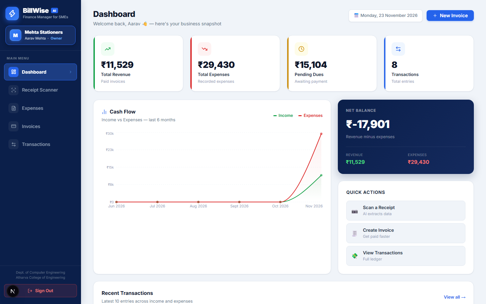
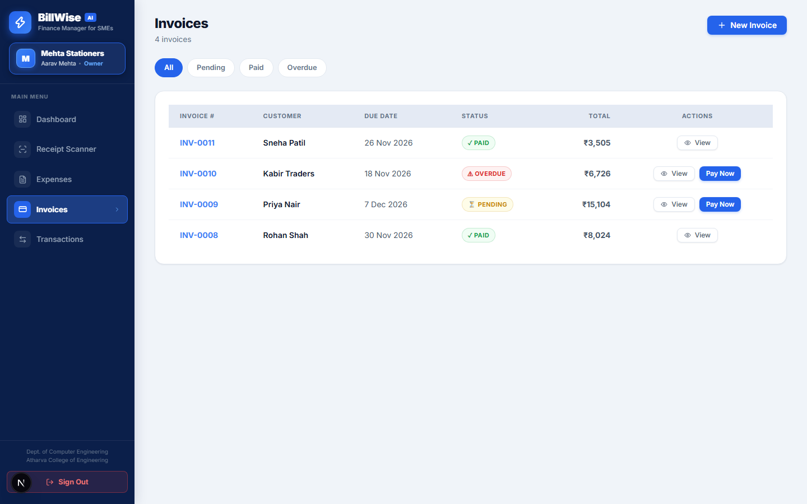
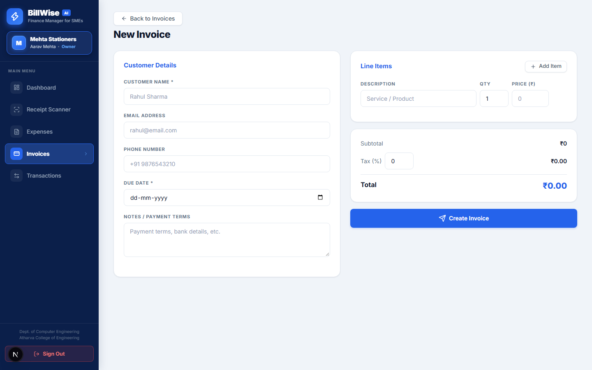
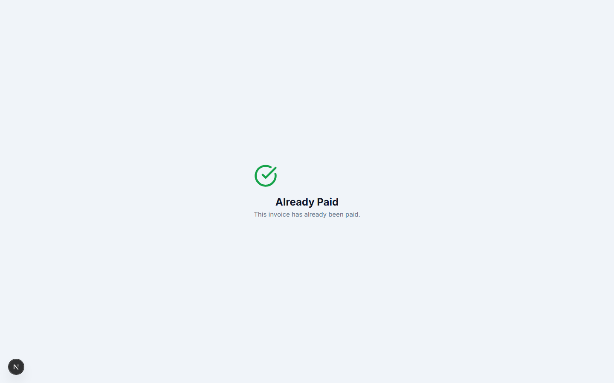
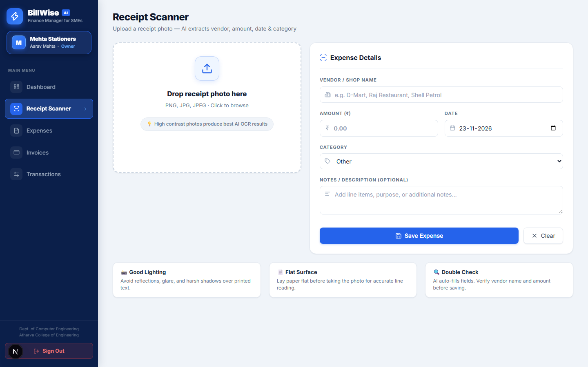
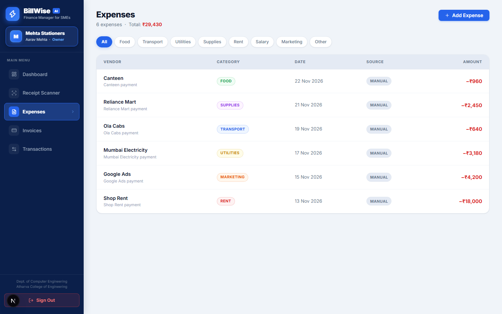
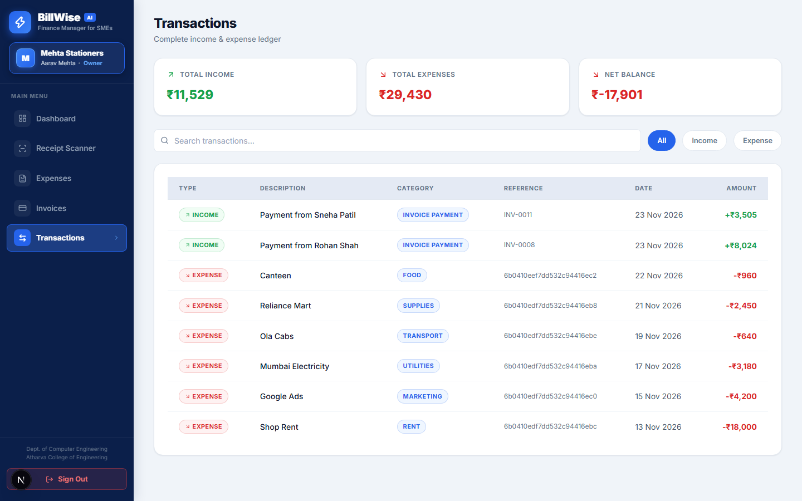
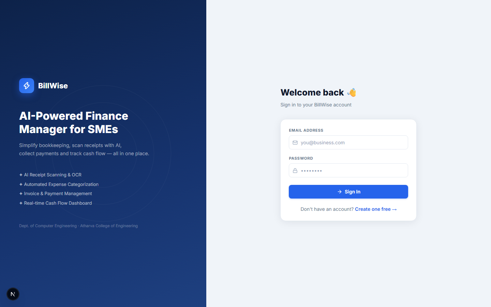

# BillWise

**An AI-assisted finance manager for small businesses.** Create invoices, collect payments, scan receipts into expenses, and see your cash flow on one dashboard.

Built as a SE Computer Engineering (Semester III) mini project at Atharva College of Engineering, Mumbai.


## Why BillWise?

Small shop owners and freelancers often track money across paper bills, WhatsApp chats and loose receipts. BillWise brings invoicing, expenses and payment tracking into one simple web app, so you always know who owes you, what you spent, and where you stand.

## Features

- **Authentication**: register and sign in securely (NextAuth credentials login, bcrypt-hashed passwords, JWT sessions).
- **Dashboard**: income, expenses and balance at a glance, with charts powered by Recharts.
- **Invoicing**: create itemised invoices with tax, due dates and notes. Invoices carry a status of `pending`, `paid` or `overdue`.
- **Shareable payment page**: each invoice has a public `/pay/[id]` link where the customer can confirm payment.
- **Automatic bookkeeping**: when an invoice is paid, an income transaction is recorded for you.
- **Receipt scanning (OCR)**: upload a photo of a receipt. It is pre-processed in the browser, read with Tesseract.js, and the vendor, amount, date and category are auto-filled for you to review and save.
- **Expense tracking**: log expenses by category (Food, Transport, Utilities, Supplies, Rent, Salary, Marketing, Other).
- **Transaction ledger**: a single history of all income and expenses.

## Screenshots

| Dashboard | Invoices |
|---|---|
|  |  |

| Create invoice | Customer payment page |
|---|---|
|  |  |

| Receipt scanner | Expenses |
|---|---|
|  |  |

| Transactions | Login |
|---|---|
|  |  |

## Tech Stack

| Layer | Technology |
|---|---|
| Framework | Next.js (App Router), React 19 |
| Styling | Tailwind CSS 4, Lucide icons |
| Database | MongoDB with Mongoose |
| Auth | NextAuth.js (credentials), bcryptjs |
| Charts | Recharts |
| OCR | Tesseract.js |
| Hosting | Vercel |

## Getting Started

### Prerequisites

- Node.js 20 or newer
- A MongoDB database (a free [MongoDB Atlas](https://www.mongodb.com/atlas) cluster works well)

### Installation

```bash
git clone https://github.com/AK-0017/BillWise.git
cd BillWise
npm install
```

### Environment variables

Copy the example file and fill in your values:

```bash
cp .env.example .env.local
```

| Variable | Description |
|---|---|
| `MONGODB_URI` | MongoDB connection string |
| `NEXTAUTH_SECRET` | Random secret used to sign sessions (generate one with `openssl rand -base64 32`) |
| `NEXTAUTH_URL` | App URL, e.g. `http://localhost:3000` |
| `AUTH_TRUST_HOST` | Set to `true` when running behind a proxy or on Vercel |

### Run it

```bash
npm run dev
```

Open [http://localhost:3000](http://localhost:3000), register an account, and you're in.

### Other scripts

```bash
npm run build   # production build
npm start       # run the production build
npm run lint    # lint the code
npm run screenshots   # regenerate README screenshots (see scripts/screenshots.ts)
```

## Project Structure

```
app/
  api/            REST routes: auth, register, invoices, pay, expenses, transactions, dashboard
  dashboard/      Overview and charts
  invoices/       Invoice list, create, and detail pages
  pay/[id]/       Public payment page for customers
  expenses/       Expense list and entry
  receipts/       Receipt scanner (OCR)
  transactions/   Income and expense ledger
  login/ register/
components/       Shared UI (Sidebar, Providers)
lib/              Auth config and MongoDB connection
models/           Mongoose schemas: User, Invoice, Expense, Transaction
```

## Team

| Name | Class |
|---|---|
| Atharva Kulkarni | SE Computer Engineering |
| Sufyan Kazi | SE Computer Engineering |
| Bhuvi Jain | SE Computer Engineering |
| Swar Bodke | SE Computer Engineering |

**Project guide:** Prof. Anjali Jha
Department of Computer Engineering, Atharva College of Engineering, Mumbai.

## Roadmap

- Real payment gateway integration (UPI / Razorpay) in place of manual confirmation
- Automatic overdue detection and payment reminders
- PDF export for invoices
- Staff accounts with role-based access

## License

Built for academic purposes. All rights reserved by the authors.
